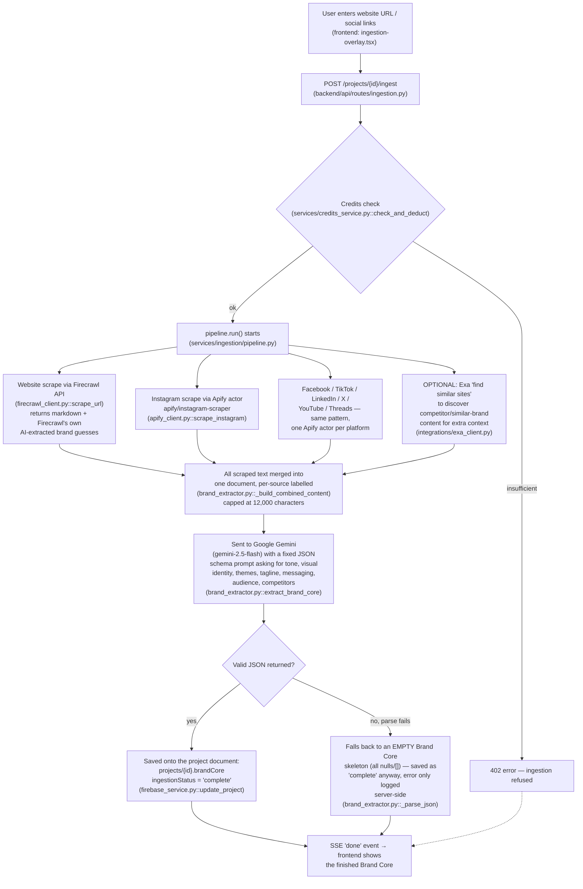

# Leo — Architecture Overview (Plain-English Edition)

*Written for a co-founder or investor with no engineering background. Every factual claim below is followed by a parenthetical pointer to the file/function it came from, so an engineer can re-verify it in seconds. This document describes the code as it exists today — it does not describe the roadmap.*

---

## 1. What actually happens when someone uses Leo

Think of Leo as a marketing hire who does their homework before ever writing a word for you. When you first set up a project, you hand Leo your website and social profiles; Leo reads all of it — like a new employee skimming your whole website and Instagram feed on day one — and writes itself a one-page "cheat sheet" about your brand: your tone of voice, your colours, your audience, your taglines. That cheat sheet is called the **Brand Core**, and it's saved permanently against your project.

From then on, every time you chat with Leo — "write me 3 Instagram captions," "draft a cold email sequence," "build me an SEO brief" — Leo pulls that cheat sheet back out, silently pastes it into its own instructions before it even starts typing, and then writes your content so it sounds like *your* brand rather than a generic AI. If your question needs something Leo can't know from memory (what a competitor posted last week, current market trends), Leo can pause mid-answer, run a live web search, read the results, and then finish answering — the same way a person might open a new browser tab mid-conversation. The whole thing runs as one continuous chat: no separate "SEO tool" or "ad tool" to switch into — those are just different kinds of answers Leo can produce inside the same conversation. Every account also has a running "credit balance" (like a phone data plan) that gets spent per action, which is how the product pays for the AI and search calls under the hood.

---

## 2. How Brand Core gets built

**Sources it can pull from:** a website URL, and/or an Instagram handle, Facebook page, TikTok profile, LinkedIn company page, X/Twitter profile, YouTube channel, or Threads profile — any combination, at least one is required (`backend/services/ingestion/pipeline.py::run`).

**What actually happens, step by step:**



Progress is streamed live to the browser the whole time (an SSE / Server-Sent Events connection — a one-way live feed from server to browser, like a sports score ticker) so the user sees each step ("Scraping website…", "Detecting colour palette…") rather than a blank loading spinner (`backend/api/routes/ingestion.py`, consumed by `frontend/src/components/brand-core/ingestion-overlay.tsx`).

**Where it's stored:** the whole Brand Core is one JSON blob nested inside the project's Firestore document (`projects/{projectId}` → field `brandCore`) — it is not a separate collection or table. There is no version history; every re-ingestion overwrites the previous Brand Core outright.

---

## 3. How a chat request gets handled

This is the main "conversation" surface — the screen where a user actually talks to Leo (`frontend/src/app/projects/[projectId]/chats/[chatId]/page.tsx` → `backend/api/routes/stream.py::send_message`). A **synchronous** step below means the user's browser is waiting on it before anything streams back; **async/background** means it happens without blocking the reply.

```mermaid
sequenceDiagram
    participant Browser
    participant NextProxy as Next.js proxy (/api/backend)
    participant API as FastAPI (stream.py)
    participant Auth as Firebase Auth
    participant DB as Firestore
    participant Credits as Credits service
    participant Mod as Moderation (background)
    participant Claude as Anthropic Claude
    participant Tools as Exa / Tavily search

    Browser->>NextProxy: POST /chats/{id}/messages\n(Firebase ID token, message text)
    NextProxy->>API: forwarded (rewrite proxy, next.config.mjs)
    API->>Auth: verify ID token (sync)
    API->>DB: check project membership (sync)
    API->>Credits: check + atomically deduct credits (sync, Firestore transaction)
    Note over API,Credits: If this fails, request is rejected (HTTP 402)\nbefore any Claude call happens.
    API->>DB: save user message (sync)
    API-->>Mod: fire-and-forget moderation scan (async, does not block reply)
    API->>DB: load last 50 messages, cached brand memory,\nkeyword-matched knowledge-base chunks (sync)

    API-->>Browser: SSE status: "Analyzing your request"
    API-->>Browser: SSE status: "Loading brand context"
    API-->>Browser: SSE status: "Thinking"

    alt No Exa/Tavily key configured
        API->>Claude: true token-by-token stream (stream_chat)
        Claude-->>Browser: SSE delta events, one per token chunk, live
    else Exa or Tavily key configured (this is the default in this deployment)
        API->>Claude: single non-streaming call with search tools offered\n(stream_chat_with_tools)
        Claude-->>API: full response returned at once
        API-->>Browser: response re-chunked into ~40-char pieces\nand sent as SSE deltas to *simulate* streaming
        opt Claude asks to use a tool
            API-->>Browser: SSE tool_call event
            API->>Tools: web_search / find_similar_companies /\nresearch_topic / get_brand_news
            Tools-->>API: results (Tavily tried first for general/news,\nExa first for company search; each\nfalls back to the other on failure)
            API-->>Browser: SSE tool_result event
            API->>Claude: results fed back, loop continues (max 3 rounds)
        end
    end

    API-->>Browser: SSE [DONE]
    API->>DB: save full assistant reply (sync, after stream ends)
    API->>DB: increment user's message count for billing (sync)
```

If the message contains structured content (captions, ad copy, a campaign brief, etc.), Claude is instructed to wrap it in a special `<artifact type="...">…</artifact>` block, which the frontend detects and renders as an interactive card instead of plain text (`backend/services/llm_service.py::ARTIFACT_INSTRUCTIONS`, rendered by `frontend/src/components/chat/artifact-cards.tsx`).

There is a **second, separate chat surface** — "Brand Intelligence Chat" — that answers questions about your own brand data using true vector-embedding retrieval (Google `text-embedding-004`) rather than the keyword-matching used above (`backend/api/routes/brand_chat.py`, `backend/services/rag_service.py`). It is a distinct feature from the main chat described above, not a variant of it.

---

## 4. External dependencies

Compiled from the environment-variable list in `backend/config.py` cross-checked against actual call sites in the code (not just declared keys — several keys are declared but never called, flagged below).

| Service | What it's used for | Data sent to it | Data returned | Critical path? |
|---|---|---|---|---|
| **Anthropic Claude** (`claude-sonnet-4-6` default) | Every chat reply; also single-shot analysis calls (SWOT, competitor synthesis) (`llm_service.py`) | User message, chat history (last 20 turns), Brand Core text, system instructions, optional images | Generated text / tool-use requests | **Critical** — chat is unusable without it |
| **Google Gemini** (`gemini-2.5-flash`) | One-shot Brand Core extraction from scraped content (`brand_extractor.py`); Imagen 3 image generation; embeddings for Brand Intelligence Chat (`rag_service.py`) | Combined scraped brand text (ingestion); image prompts; text chunks (embeddings) | Structured Brand Core JSON; generated images; embedding vectors | **Critical** for ingestion & Brand Intelligence Chat; optional for images |
| **OpenAI** (DALL·E 3) | Fallback/alternate image generation (`services/image_service.py`) | Image prompt text | Generated image | Optional — feature returns 503 if unset (`main.py` lifespan check) |
| **Firecrawl** | Website scraping into clean markdown during ingestion (`ingestion/firecrawl_client.py`) | Target URL | Page markdown, metadata, an AI-extracted guess at brand attributes | Optional per-source, but ingestion fails entirely if no source scrapes successfully |
| **Apify** | Social profile scraping — separate actor per platform: Instagram (`apify/instagram-scraper`), Facebook, TikTok, LinkedIn, X/Twitter, YouTube, Threads (`ingestion/apify_client.py`) | Handle/profile URL | Bio, recent posts/captions, follower-adjacent metadata | Optional per-source |
| **Exa.ai** | Semantic web search, "find similar companies," cited research answers, competitor discovery (`integrations/exa_client.py`, `tool_dispatcher.py`) | Search query or seed URL | Search results / synthesized answer with citations | Optional — chat/ingestion degrade gracefully if unset, but this is the *default* configured provider |
| **Tavily** | General web search, news search, content extraction — primary fallback/partner to Exa (`integrations/tavily_client.py`) | Search query | Search results, optional synthesized answer | Optional, same as above |
| **SerpAPI** | Raw Google SERP data for SEO tooling and competitor discovery (used across `services/pillar3/*` and `blog/serp_content_service.py`, 12 call sites found) | Search query | Ranked search results | Optional — SEO pillar features degrade without it |
| **Firebase Firestore** | The single database for every domain object in the product (projects, chats, messages, content library, campaigns, etc.) (`services/firebase_service.py`) | Every piece of app data | Same | **Critical** — nothing works without it |
| **Firebase Auth** | User sign-up/login, ID-token verification on every API request (`middleware/auth.py`) | Email/password at signup; bearer token per request | Verified user identity claims | **Critical** |
| **Cloudflare R2** | Object storage for uploaded logos/media and generated images (`api/routes/assets.py`) | Image/video bytes | A public URL | Optional — silently falls back to storing the file as base64 text *inside* the Firestore document if unset or if the upload fails |
| **Stripe** | Subscription billing (Free/Pro/Agency), webhook-driven plan changes (`services/stripe_service.py`) | Customer email, plan selection | Checkout/portal session URLs, webhook events | Critical for paid plans; irrelevant to product function on the Free tier |
| **Resend** | Transactional email — invites, notifications (4 call sites) | Recipient email, message content | Delivery status | Optional |
| **Ayrshare** | Actual publishing/scheduling of posts to social platforms for "Personal Brand" projects (`services/personal_brand/ayrshare_service.py`) | Post content, target platform, a per-project "profile key" | Publish confirmation / scheduling ID | Optional — only used by the Personal Brand feature |
| **Logo.dev / Brandfetch / Brand.dev** | Fetching a brand's logo, colours, and detected fonts by domain, used in the Carousel Studio feature (`services/carousel/brand_scraper.py`) | Domain name | Logo image URL, colour palette, font names | Optional |
| **Apollo.io** | CRM/lead firmographic enrichment (`integrations/apollo_client.py`) | Company/person identifiers | Firmographic data | Optional |
| **HubSpot, Loops.so, ZeroBounce** | Pillar 5 (email marketing/CRM) integrations — contact sync, list sends, email validation | Contact data, email addresses | Sync/validation results | Optional, per-feature |
| **Google Analytics 4 / Google Search Console** | Pillar 7 analytics + Pillar 3 SEO tooling, per-user OAuth | OAuth token, property/site ID | Traffic/search performance data | Optional, requires the end user to connect their own Google account |
| **YouTube Data API** | Channel/video data (2 call sites) | Channel/video ID | Public channel stats | Optional |
| **Sentry** | Error tracking, initialised first thing at process start if `SENTRY_DSN` is set (`main.py::_init_sentry`) | Stack traces, request metadata (PII stripped: `send_default_pii=False`) | — | Optional, off unless configured |
| **Groq, OpenRouter, NVIDIA NIM** | Declared as LLM provider keys in config and listed in the admin integrations panel (`api/routes/admin.py`) | — | — | **Not actually called anywhere in the codebase** — configured but dead. See §6. |
| **Google Ads API, native Meta/LinkedIn/TikTok/X OAuth app credentials, PostHog** | Declared in `config.py` | — | — | **Not actually called anywhere in the codebase** — configured but dead. See §6. |

---

## 5. Data storage map

Everything lives in one **Firebase Firestore** database (a cloud NoSQL document database — think nested folders of JSON documents rather than spreadsheet-style tables) organized under two top-level collections, `users/` and `projects/`, plus a handful of platform-wide collections. Retention is **indefinite** — no code path found that expires or deletes data automatically except where noted.

| What's stored | Where (Firestore path) | Expiry / retention |
|---|---|---|
| Brand Core | `projects/{id}` field `brandCore` (nested in the project doc, not its own collection) | Indefinite; overwritten wholesale on re-ingestion |
| Chats & messages | `projects/{id}/chats/{chatId}/messages/{messageId}` | Indefinite. Only the last 50 messages are ever loaded per chat (`settings.MESSAGES_LOAD_LIMIT`), and only the last 20 are sent to Claude as context (`settings.LLM_CONTEXT_MESSAGES`) |
| Brand memory (user feedback/instructions Leo should remember) | `projects/{id}/brand_memory/{feedbackId}` | Indefinite; last 40 items loaded and cached in-process for 5 minutes per project (`cache_service.py`, `TTL_BRAND_CONTEXT`) |
| Content library, calendar, campaigns, templates, posts, generated images | `projects/{id}/content_library`, `calendar_entries`, `campaigns`, `templates`, `posts`, `generated_images` | Indefinite |
| Competitor snapshots / profiles, research reports, monitor alerts | `projects/{id}/competitor_snapshots`, `competitor_profiles`, `research_reports`, `monitor_alerts` | Indefinite |
| Web search results cache | `projects/{id}/web_search_cache` (Firestore-backed) | Config anticipates a 6-hour TTL (`settings.SEARCH_CACHE_TTL_HOURS`) but this is a **declared setting with no confirmed enforcing code path found** during this review — flagged as ambiguous, not verified |
| Credits & billing state | `users/{uid}` fields `credits`, `tier`; transaction log at `users/{uid}/creditTransactions` | Indefinite; balance resets daily (Free) or monthly (Pro/Agency) |
| Flagged/moderated content | `flaggedContent/{id}` (top-level, not per-project) | Indefinite; admin-reviewed, never auto-deleted |
| Uploaded/generated images & video | Cloudflare R2 bucket if configured, **else** base64-encoded directly inside the relevant Firestore document | Indefinite; no lifecycle policy found |
| Uploaded knowledge-base documents | `projects/{id}/rag_index` (chunks + embedding vectors) for Brand Intelligence Chat; separate chunk store for the keyword-based main-chat knowledge base | Indefinite |
| In-process caches (search results, brand memory, per-request rate limits) | Server RAM only (Python dict, `cache_service.py`; SlowAPI in-memory limiter, `middleware/rate_limit.py`) | Cleared on every server restart or deploy; **not shared across multiple server instances** — see §6 |

---

## 6. Known gaps and fragile points

Reported plainly, not softened — a co-founder deck should reflect what's actually true of a prototype.

1. **The "tool-enabled" chat path doesn't truly stream.** Whenever an Exa or Tavily key is configured (the default setup), the assistant's reply is generated with a single blocking, non-streaming Claude call, then artificially chopped into ~40-character pieces and sent as if it were streaming (`llm_service.py::stream_chat_with_tools`, comment: *"tools require non-stream for reliability"*). Users on this path wait for the full response to be ready server-side before seeing anything, unlike the plain path which streams token-by-token. Because search keys are configured in this deployment, this is the path most users are actually on.

2. **Ingestion can silently produce an empty Brand Core.** If Gemini's response fails to parse as valid JSON, the code returns an all-null/empty skeleton and the pipeline still reports `ingestionStatus: "complete"` and shows a "done" state to the user — the failure is only visible in server logs (`brand_extractor.py::_parse_json`). A user could believe their Brand Core is set up when it's actually blank.

3. **In-memory state won't survive scaling past one server process.** Both the request-rate limiter (`middleware/rate_limit.py`, SlowAPI default in-memory backend) and the brand-context/search cache (`services/cache_service.py`) live in the Python process's RAM. They reset on every deploy/restart and give each server instance its own independent view — fine for a single-instance prototype, but rate limits and caching will silently stop working correctly the moment the backend runs on more than one instance.

4. **Media can end up stored as base64 text inside Firestore documents.** If Cloudflare R2 isn't configured, or an R2 upload throws for any reason, logo/media uploads fall back to embedding the raw file as base64 text in the Firestore document itself (`api/routes/assets.py`). Firestore documents have a 1 MiB hard size limit, so larger files in this fallback path will fail outright rather than degrade gracefully.

5. **Credits are deducted before some downstream failures are possible.** In the chat route, credits are checked-and-deducted (`check_and_deduct_atomic`) *before* the code confirms the target chat actually exists (`firebase_service.get_chat` — a 404 case is still checked after the deduction). No refund path was found for this ordering.

6. **Moderation is entirely after-the-fact.** `services/moderation_service.py` scans messages for abuse/prompt-injection patterns as a background task that runs *after* the message is already saved and already sent to Claude — by the module's own docstring, this is "purely for review, not for real-time blocking." There is no real-time content gate.

7. **Several configured integrations are dead code.** `GROQ_API_KEY`, `OPENROUTER_API_KEY`, and `NVIDIA_NIM_API_KEY` are declared in `config.py` and even surfaced in the admin integrations panel (`api/routes/admin.py`), but no code path anywhere calls out to them — they cannot currently do anything. Similarly, `GOOGLE_ADS_DEVELOPER_TOKEN`/`GOOGLE_ADS_CUSTOMER_ID`, the native OAuth app credentials for Meta/LinkedIn/TikTok/X (`META_APP_ID/SECRET`, `LINKEDIN_CLIENT_ID/SECRET`, `TIKTOK_CLIENT_KEY/SECRET`, `X_BEARER_TOKEN`/`X_CLIENT_ID/SECRET`), and `POSTHOG_API_KEY` have zero call sites outside `config.py`. This matters for anyone reading the admin panel or `.env.example` and assuming a feature is live because its key slot exists.

8. **Actual social publishing goes through a third-party reseller, not the platforms directly.** Despite dedicated Meta/LinkedIn/TikTok/X OAuth credential slots existing in config (all unused, per #7), the only working "publish to social media" code path goes through Ayrshare (`services/personal_brand/ayrshare_service.py`), a paid third-party API that itself manages the platform connections. This is a single external vendor dependency for a core promised capability, and it's scoped only to the Personal Brand feature — there is no equivalent for business/brand projects in the code reviewed.

9. **The "web search cache" TTL setting may not be enforced.** `settings.SEARCH_CACHE_TTL_HOURS` (default 6h) is declared and a `web_search_cache` Firestore collection exists, but this review did not find the code path that actually reads/writes/expires it against that setting — flagged as ambiguous rather than asserted either way; worth a direct question to whoever last touched `services/integrations/exa_client.py` / `tavily_client.py`.

10. **`README.md` at the repo root describes a different, older project** (a hackathon-style "Growth Intelligence Engine" with an in-memory-only store and a completely different file layout — `frontend/agents/`, `backend/agents/`, etc.) that does not match the current codebase at all. It appears to be stale and should not be used as a reference for how Leo actually works today; this document supersedes it. `LEO_TECHNICAL_OVERVIEW.md` (root) is closer to current but was self-written by a prior session and contains at least two inaccuracies caught during this review (it states Next.js 15 — the codebase pins **Next.js 14.2.35** in `frontend/package.json`; and it undersells how much of the "pillar" service layer is actually wired into live API routes rather than scaffolding).

---

## Tech stack, confirmed from code (not assumed)

- **Backend:** Python, FastAPI `0.135.1`, deployed via Docker to Railway (`railway.toml`, `backend/Dockerfile`)
- **Frontend:** Next.js `14.2.35` (App Router), React 18, Zustand for state, deployed to Vercel (`frontend/vercel.json`)
- **Database & Auth:** Firebase Firestore + Firebase Authentication
- **Primary LLM:** Anthropic Claude (`claude-sonnet-4-6` by default, configurable via `LLM_CHAT_MODEL`); Google Gemini `2.5-flash` for one-shot extraction/embeddings/images
- **Frontend ↔ backend link:** the browser talks to `/api/backend/*`, which Next.js rewrites to the FastAPI backend's URL (`frontend/next.config.mjs`) — there is no separate API gateway
